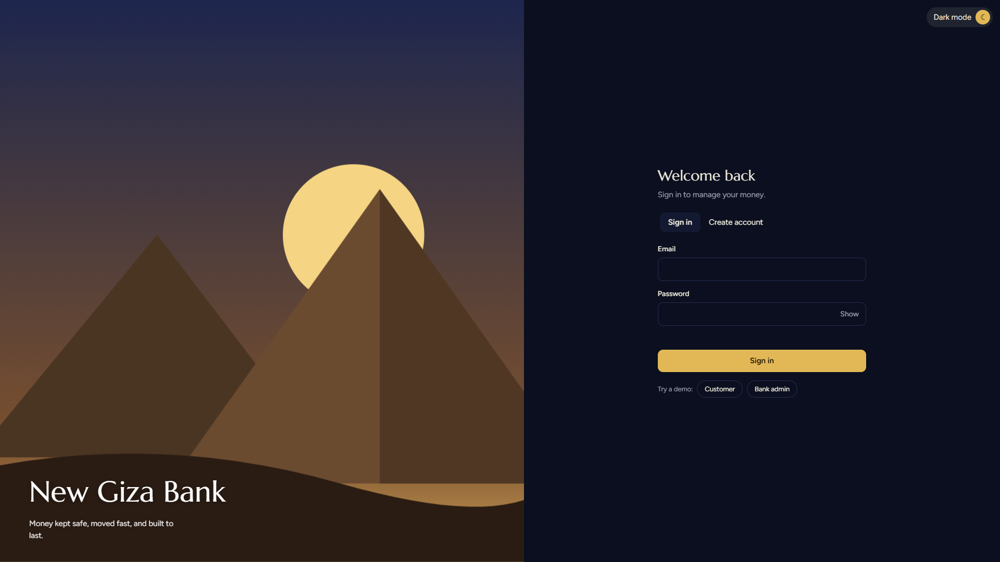
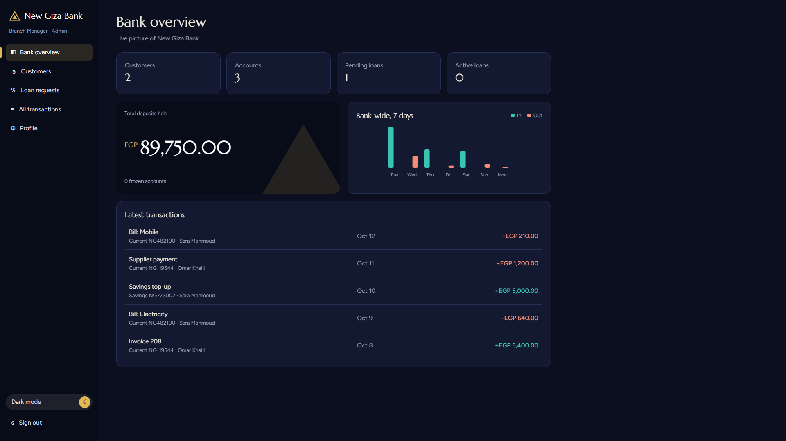
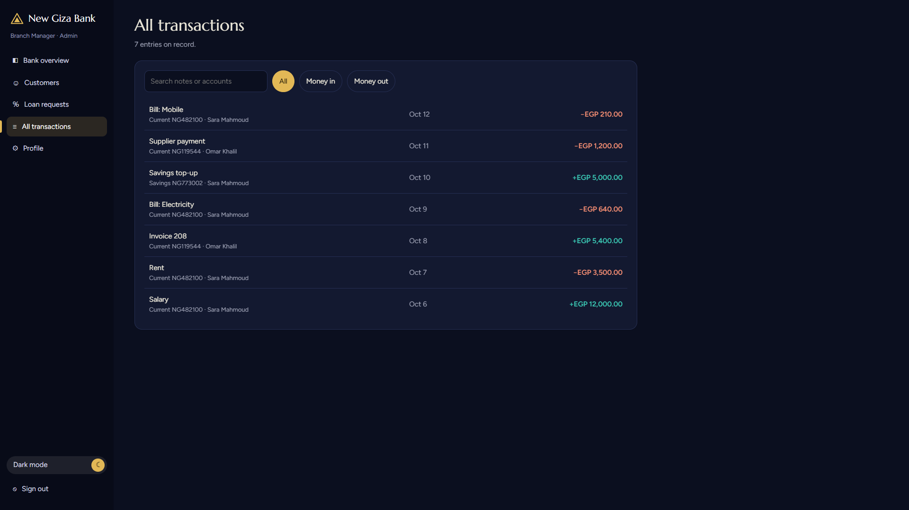

# New Giza Bank

<p align="center">
  <strong>A Modern Banking Management Web Experience</strong>
</p>

<p align="center">
  A sleek and interactive banking management prototype featuring customer and administrator portals, smooth animations, and elegant light and dark themes.
</p>

<p align="center">
  <a href="https://new-giza-bank.vercel.app/"><strong>Live Demo</strong></a>
  &nbsp; • &nbsp;
  <a href="https://github.com/im-mohannad-devs/New-Giza-Bank"><strong>Source Code</strong></a>
</p>

---

## Screenshots

<p align="center">
  
</p>

<p align="center">
  <em>Login Page — A clean interface with customer and administrator access.</em>
</p>

<br>

<table>
  <tr>
    <td width="50%" align="center">
      
      <br>
      <strong>Admin Dashboard</strong>
    </td>
    <td width="50%" align="center">
      
      <br>
      <strong>Transaction Management</strong>
    </td>
  </tr>
</table>

---

## Overview

**New Giza Bank** is a front-end banking management prototype designed to demonstrate modern web development, interactive user interfaces, and organized JavaScript architecture.

The application provides separate customer and administrator experiences in a simulated banking environment, with an emphasis on usability, visual consistency, and responsive design.

## Features

- **Customer Portal** — A dedicated interface for customer-facing banking features.
- **Admin Dashboard** — An overview of customers, accounts, loan requests, and transactions.
- **Interactive Login** — Login interface with customer and administrator demo access.
- **Light & Dark Mode** — Switch between themes for a more comfortable browsing experience.
- **Transaction Management** — Browse and filter transaction records.
- **Interactive UI** — Forms, buttons, navigation, and other dynamic components.
- **Smooth Animations** — Transitions that enhance the overall user experience.
- **Browser Storage** — Demo data persistence using browser storage where implemented.
- **Modular JavaScript** — Application logic organized across multiple files.

## Tech Stack

<p>
  
  
  
  
  
  
</p>

| Technology | Purpose |
|---|---|
| HTML5 | Page structure and content |
| CSS3 | Layouts, visual styling, themes, and animations |
| JavaScript (ES6+) | Application logic and user interactions |
| LocalStorage | Browser-based demo data persistence, where implemented |
| Git & GitHub | Version control and source code hosting |
| Vercel | Deployment and live preview |

## Live Demo

Explore the deployed application:

**[Launch New Giza Bank](https://new-giza-bank.vercel.app/)**

## Getting Started

### Prerequisites

- A modern web browser.
- Git, if you want to clone the repository.
- Visual Studio Code (recommended).

### Installation

**1. Clone the repository**

```bash
git clone https://github.com/im-mohannad-devs/New-Giza-Bank.git
```

**2. Navigate to the project directory**

```bash
cd New-Giza-Bank
```

**3. Run the application**

Open `index.html` in your browser, or use the Live Server extension in Visual Studio Code.

No package installation or build step is required for this static front-end project.

## Project Structure

```text
New-Giza-Bank/
├── assets/
│   ├── login-page.png
│   ├── admin-dashboard.png
│   └── transactions.png
├── css/
│   └── style.css
├── js/
│   ├── core.js
│   ├── views.js
│   ├── actions.js
│   └── main.js
├── favicon.svg
├── index.html
├── LICENSE
└── README.md
```

## Security & Limitations

New Giza Bank is an educational front-end prototype, not a real banking service.

- Authentication is simulated on the client side.
- Browser storage is not a secure database.
- The application does not provide production-grade authentication or financial security.
- Do not enter real banking credentials, personal information, or financial data.

A production banking system would require a secure backend, a database, server-side authentication and authorization, session management, input validation, and additional security controls.

## Future Improvements

Potential enhancements include:

- Backend API and database integration.
- Secure server-side authentication and authorization.
- Expanded customer and administrator workflows.
- Automated testing and improved error handling.
- Further accessibility and responsive design improvements.

## License

This project is licensed under the **MIT License**. See the [LICENSE](LICENSE) file for details.

## Author

**Mohannad Nader**

- GitHub: [@im-mohannad-devs](https://github.com/im-mohannad-devs)
- Project Repository: [New Giza Bank](https://github.com/im-mohannad-devs/New-Giza-Bank)
- Live Demo: [New Giza Bank on Vercel](https://new-giza-bank.vercel.app/)

---

<p align="center">
  Built with HTML, CSS, and JavaScript.
</p>
